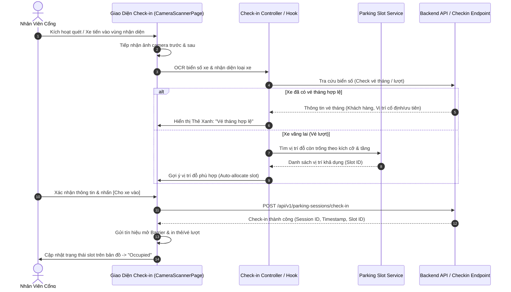
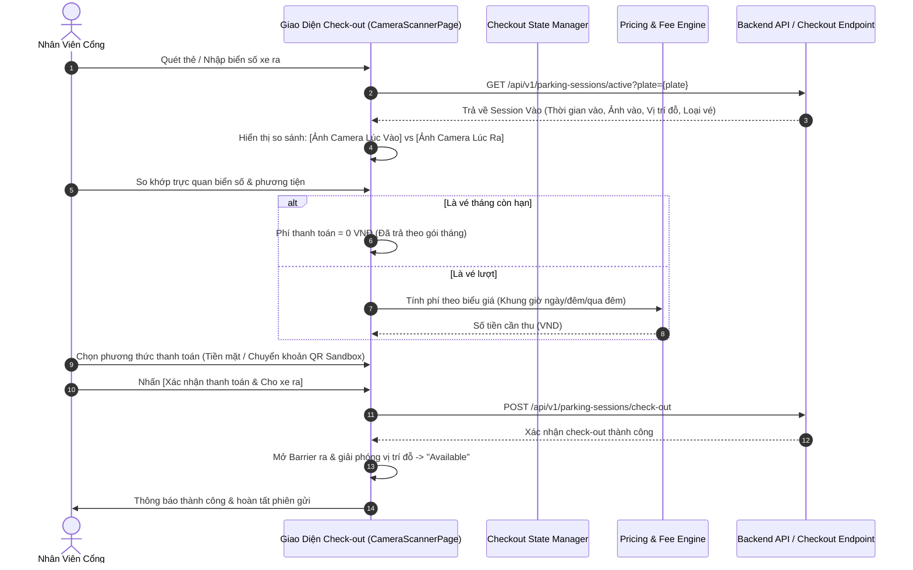
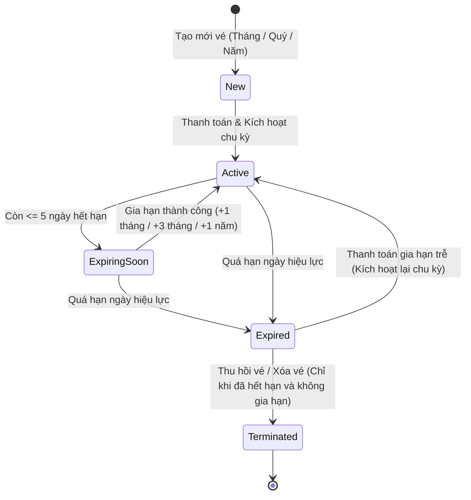
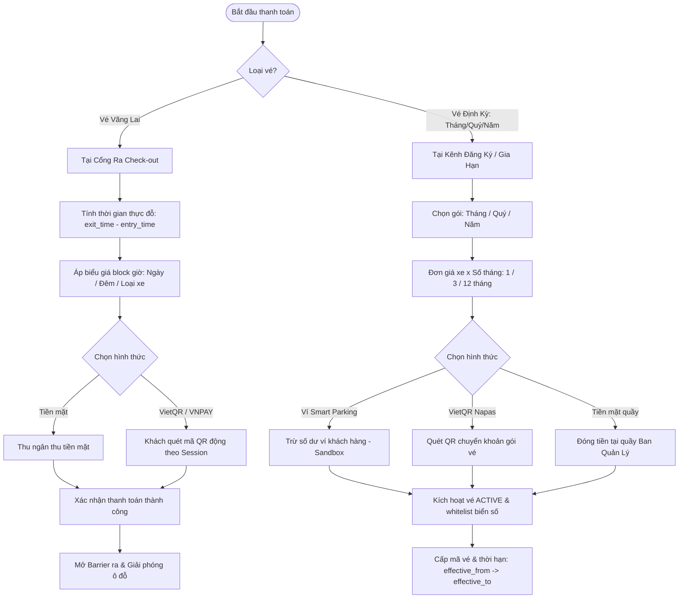

# Luồng Nghiệp Vụ Chính (Core Business Workflows) - Frontend

Tài liệu này tổng hợp và mô hình hóa chi tiết các luồng nghiệp vụ cốt lõi (Core Business Workflows) của ứng dụng Frontend **Hệ thống Quản lý Bãi đậu xe Ô tô (Smart Mobility)**. Được chuẩn hóa dựa trên tài liệu SRS v4.1, SRS Traceability (TL-01 đến TL-49) và kiến trúc phân lớp Frontend.

---

## 1. Bản Đồ Tổng Thể Luồng Nghiệp Vụ (Workflow Big Picture)

```text
                           +----------------------+
                           |   Đăng Nhập (Auth)   |
                           +----------+-----------+
                                      |
                      [Xác thực & Phân quyền Role]
                                      |
                                      v
                           +----------------------+
                           |   Trang Chủ (Home)   |
                           +----------+-----------+
                                      |
        +-----------------------------+-----------------------------+
        |                             |                             |
        v                             v                             v
+---------------+             +---------------+             +---------------+
| VẬN HÀNH CỔNG |             | KHÁCH HÀNG &  |             | QUẢN TRỊ BÃI  |
| (Check-in/out)|             |    VÉ XE      |             | & BÁO CÁO     |
+-------+-------+             +-------+-------+             +-------+-------+
        |                             |                             |
  1. Xe Vào Bãi                 3. Cấp Vé Tháng               5. Bản Đồ & Vị Trí
  2. Xe Ra Bãi                  4. Gia Hạn Vé                 6. Thống Kê & Báo Cáo
```

---

## 2. Luồng Nghiệp Vụ 1: Kiểm Soát Xe Vào Bãi (Vehicle Check-in Flow)

### 2.1. Mục Tiêu & Tác Nhân
- **Mục tiêu**: Tiếp nhận xe tại cổng vào, chụp ảnh nhận diện biển số, phân loại vé (lượt / tháng), điều phối vị trí đỗ còn trống phù hợp và mở barrier cho xe vào.
- **Tác nhân**: Nhân viên cổng (Staff), Hệ thống Camera Scanner / ANPR.

### 2.2. Sơ Đồ Quy Trình (Sequence Diagram)



### 2.3. Quy Tắc Nghiệp Vụ & Ràng Buộc Frontend
- **Zero Fake Data**: Biển số xe và hình ảnh nhận diện hiển thị chính xác từ camera stream hoặc OCR engine.
- **Slot Capacity Guard**: Không cho phép check-in nếu tầng đỗ hoặc bãi đã đạt 100% sức chứa (Báo lỗi `Bãi xe đầy - Không thể nhận thêm xe`).
- **Phân loại vé tại cổng vào**:
  - **Khách hàng đăng ký dài hạn (Vé Định Kỳ)**: Vé Tháng (Monthly), Vé Quý (Quarterly - 3 tháng), Vé Năm (Yearly - 12 tháng). Hệ thống kiểm tra hạn sử dụng: nếu còn hạn thì hiển thị trạng thái hợp lệ, tự động gán slot tương ứng. Nếu đã hết hạn, hệ thống cảnh báo đỏ và gợi ý xử lý như vé vãng lai hoặc gia hạn ngay.
  - **Khách hàng vãng lai (Chưa đăng ký)**: Phát hành vé vãng lai (Vé lượt / Guest Ticket) tự động gắn với biển số xe nhận diện tại thời điểm check-in (hoặc phát thẻ từ vãng lai / mã QR tạm thời) mà không bắt buộc phải khai báo hồ sơ khách hàng đầy đủ.

---

## 3. Luồng Nghiệp Vụ 2: Kiểm Soát Xe Ra Bãi & Tính Phí (Vehicle Check-out Flow)

### 3.1. Mục Tiêu & Tác Nhân
- **Mục tiêu**: Kiểm tra tính hợp lệ của phương tiện rời bãi (so khớp biển số vào/ra, ảnh xe, thẻ vé), tính toán thời gian lưu bãi và mức phí gửi xe, xác nhận thanh toán trước khi mở barrier ra.
- **Tác nhân**: Nhân viên cổng (Staff), Khách gửi xe.

### 3.2. Sơ Đồ Quy Trình (Sequence Diagram)



### 3.3. Quy Tắc Nghiệp Vụ & Ràng Buộc Frontend
- **Mismatch Alert**: Nếu biển số nhận diện lúc ra khác biển số lúc vào, hệ thống highlight cảnh báo đỏ lập tức và yêu cầu nhân viên xác minh thủ công bằng CMND/Đăng ký xe.
- **Minh bạch tài chính**: Mọi giao dịch thu tiền / quét mã QR chuyển khoản khi chưa kết nối ngân hàng thật phải hiển thị tag `Sandbox / Mô phỏng` theo chuẩn AI Clean Code.
- **Giải phóng vị trí tức thì**: Ngay khi check-out hoàn tất, bản đồ bãi xe cần cập nhật vị trí tương ứng về trạng thái trống (Empty/Available) qua WebSocket/SSE hoặc mutation invalidate.

---

## 4. Luồng Nghiệp Vụ 3: Đăng Ký & Quản Lý Khách Hàng - Phương Tiện (Customer & Vehicle Registration)

### 4.1. Mục Tiêu & Tác Nhân
- **Mục tiêu**: Lưu trữ thông tin định danh của khách hàng thân thiết, khách cư dân, đăng ký xe sở hữu để làm căn cứ cấp vé tháng.
- **Tác nhân**: Quản lý (Admin), Nhân viên (Staff).

### 4.2. Sơ Đồ Luồng Dữ Liệu (Form Flow)

```text
[Bảng Khách Hàng] 
       |
       +---> [Nút: Thêm Mới Khách Hàng]
                   |
                   v
             [Form Thông Tin Khách Hàng]
             - Họ và tên, SĐT, Email
             - CMND/CCCD, Địa chỉ
                   |
                   v
             [Section: Danh Sách Xe Sở Hữu]
             - Biển số xe (Plate Number)
             - Hãng xe, Model, Loại xe (4 chỗ, 7 chỗ, Bán tải...)
             - Màu xe
                   |
                   +---> [Thêm/Xóa nhanh dòng phương tiện]
                   |
                   v
             [Validate Schema Client-side (Yup/Zod)]
                   |
             +-----+-----+
             |           |
        (Không hợp lệ)  (Hợp lệ)
             |           |
             v           v
     [Hiển thị lỗi]   [POST /api/v1/customers]
                         |
                         v
                [Cập nhật bảng & Toast thông báo]
```

### 4.3. Quy Tắc Nghiệp Vụ & Ràng Buộc Frontend
- Biển số xe phải tuân thủ regex định dạng biển số xe cơ giới Việt Nam (VD: `51A-123.45`, `29B-999.88`).
- Kiểm tra tính duy nhất: Một biển số xe không thể đồng thời đăng ký hoạt động dưới 2 khách hàng khác nhau.
- Số CMND/CCCD và Số điện thoại phải được validate chặt chẽ (10 số với SĐT, 9 hoặc 12 số với CMND/CCCD).

---

## 5. Luồng Nghiệp Vụ 4: Quản Lý Phân Loại, Cấp & Gia Hạn Vé (Ticket Categories, Issuance & Renewal)

### 5.1. Phân Loại Vé & Đối Tượng Sử Dụng (Ticket Categories)

Hệ thống phân chia 2 nhóm vé chính:

| Nhóm Vé | Loại Vé | Chu Kỳ / Thời Hạn | Đối Tượng Áp Dụng | Quy Trình Đăng Ký |
| :--- | :--- | :--- | :--- | :--- |
| **Vé Vãng Lai (Guest / Casual)** | **Vé Lượt / Khách Vãng Lai** | Từng lượt gửi (tính theo block giờ hoặc qua đêm) | Khách vãng lai, khách chưa từng đăng ký tài khoản trong hệ thống | **Không cần đăng ký trước**: Tạo nhanh phiên đỗ tại cổng check-in từ camera/biển số hoặc quét mã QR/thẻ từ tạm. |
| **Vé Định Kỳ (Subscription / Pass)** | **Vé Tháng (Monthly)** | 30 ngày (1 tháng) | Cư dân, nhân viên văn phòng gửi xe thường xuyên | Cần đăng ký hồ sơ khách hàng & biển số xe định danh. |
| **Vé Định Kỳ (Subscription / Pass)** | **Vé Quý (Quarterly)** | 90 ngày (3 tháng) | Khách hàng dài hạn, doanh nghiệp thuê theo quý | Cần đăng ký hồ sơ khách hàng & biển số xe định danh. |
| **Vé Định Kỳ (Subscription / Pass)** | **Vé Năm (Yearly)** | 365 ngày (1 năm / 12 tháng) | Khách hàng thân thiết, hợp đồng doanh nghiệp dài hạn | Cần đăng ký hồ sơ khách hàng & biển số xe định danh. |

### 5.2. Mục Tiêu & Tác Nhân
- **Mục tiêu**: Quản lý trọn vẹn vòng đời các loại vé: Cấp phát vé vãng lai tức thì tại cổng vào, phát hành vé định kỳ (tháng/quý/năm) mới, liên kết vị trí đỗ cố định (nếu có), gia hạn thời gian hiệu lực và xử lý thu hồi/xóa vé hết hạn.
- **Tác nhân**: Quản lý (Admin), Nhân viên trực bãi / Cổng (Staff).

### 5.3. Vòng Đời Vé Định Kỳ (Subscription Ticket State Machine)



### 5.4. Quy Trình Cấp Vé Cho Khách Vãng Lai (Chưa Đăng Ký)
1. **Tiếp nhận tại cổng**: Xe khách vãng lai tới trước barrier, camera OCR tự động quét biển số.
2. **Kiểm tra dữ liệu**: Hệ thống không tìm thấy vé định kỳ hiệu lực liên kết với biển số này.
3. **Phát hành vé vãng lai**: 
   - Hệ thống tự động tạo mã phiên (`Session ID`) hoặc cấp thẻ từ vãng lai / in vé giấy có QR code định danh lượt vào.
   - Ghi nhận `entry_time`, biển số nhận diện, ảnh chụp phương tiện và gán vị trí đỗ còn trống.
   - Không yêu cầu nhân viên phải nhập thông tin CCCD, Họ tên hay SĐT của khách.
4. **Khi xe ra**: Quét lại mã vé / nhận diện biển số ra, tính cước phí dựa trên bảng giá lượt/giờ và xuất hóa đơn/thu tiền trước khi mở barrier ra.

### 5.5. Chi Tiết Luồng Thanh Toán Vé (Ticket Payment Architecture & Workflows)

Hệ thống phân tách rõ rệt 2 ngữ cảnh thanh toán chính:

#### 1. Thanh Toán Vé Vãng Lai (Thực hiện tại Cổng Ra - Check-out Lane)
Khách vãng lai thanh toán khi kết thúc phiên đỗ thực tế:
- **Thời điểm**: Tại thời điểm xe ra khỏi bãi (`Check-out`).
- **Cơ chế tính cước**: 
  - Hệ thống tính thời gian đỗ: `duration = exit_time - entry_time`.
  - Áp dụng biểu giá luỹ tiến / block giờ (ban ngày, ban đêm, qua đêm) dựa theo loại phương tiện (`CAR`, `EV`, `BIKE`).
- **Quy trình thanh toán**:
  1. Màn hình barrier / trạm kiểm soát hiển thị tổng thời gian và số tiền cần thanh toán.
  2. Nhân viên hoặc kiosk tự động cung cấp 2 phương thức:
     - **Tiền mặt (CASH)**: Nhân viên thu tiền mặt -> Xác nhận trên giao diện -> In biên lai.
     - **Chuyển khoản VietQR / VNPAY**: Sinh mã QR động Napas 247 gắn liền với `Session ID` và số tiền chính xác -> Khách quét app ngân hàng.
  3. Sau khi xác nhận tiền đã vào tài khoản/nhân viên bấm xác nhận: Hệ thống đóng phiên đỗ (`POST /api/v1/parking-sessions/check-out`), gửi lệnh mở Barrier ra và giải phóng ô đỗ trên bản đồ.

#### 2. Thanh Toán Vé Định Kỳ (Tháng / Quý / Năm - Thu Trước / Pre-paid)
Vé định kỳ thu tiền theo hình thức **trả trước** (Pre-paid) trước khi kích hoạt hoặc gia hạn quyền vào/ra bãi:
- **Thời điểm**: Khi khách hàng đăng ký mua vé mới hoặc gia hạn vé sắp/đã hết hạn (thực hiện qua Web Portal khách hàng hoặc Quầy lễ tân/Admin).
- **Cơ chế tính cước**:
  - `Giá vé cơ sở = Đơn giá tháng của loại xe (CAR: 1.200.000đ, EV: 1.100.000đ, BIKE: 150.000đ)`.
  - `Tổng tiền thanh toán = Giá cơ sở x Số tháng` (Vé Tháng: 1 tháng, Vé Quý: 3 tháng, Vé Năm: 12 tháng). *(Ghi chú: Chính sách chiết khấu/khuyến mãi tạm thời chưa áp dụng để đảm bảo tính minh bạch và đơn giản theo biểu giá chuẩn).*
- **Phương thức thanh toán**:
  - **Ví điện tử nội bộ Smart Parking (WALLET)**: Trừ tiền trực tiếp vào số dư ví của khách hàng (hiện tại hiển thị tag *Mô phỏng/Sandbox* theo quy tắc an toàn tài chính).
  - **Chuyển khoản VietQR**: Sinh mã QR động cho khách hàng quét thanh toán với nội dung chuyển khoản chuẩn hóa (VD: `VE THANG 51A-123.45`).
  - **Tiền mặt (CASH)**: Khách đóng trực tiếp cho ban quản lý/thu ngân tòa nhà.
- **Kích hoạt hiệu lực**:
  - Ngay khi trạng thái thanh toán hoàn tất (`status = COMPLETED`), hệ thống sinh mã vé (VD: `VT-2026-101`, `VQ-2026-202`, `VN-2026-303`), kích hoạt trạng thái vé thành `ACTIVE`, ghi nhận thời hạn `effective_from` và `effective_to`.
  - Biển số xe được cập nhật vào danh sách whitelist (xe ưu tiên/xe vé tháng) tại trạm kiểm soát cổng vào/ra.



### 5.6. Quy Tắc Nghiệp Vụ Xóa & Gia Hạn Vé Định Kỳ (Theo SRS TL-03)
- **Quy tắc xóa vé**: Chỉ cho phép xóa vé khi **vé đã hết hạn** (`status === 'EXPIRED'`) và **khách hàng không có nhu cầu gia hạn**. Tuyệt đối không cho phép xóa vé đang trong thời gian hiệu lực (`ACTIVE`).
- **Gia hạn vé theo kỳ hạn**: Hỗ trợ linh hoạt chuyển đổi gói gia hạn (ví dụ: vé đang dùng gói Tháng có thể gia hạn lên gói Quý hoặc Năm).
  - Khi gia hạn, ngày bắt đầu của chu kỳ mới được tính nối tiếp từ ngày hết hạn của chu kỳ trước (nếu gia hạn trước/đúng hạn), hoặc tính từ ngày thanh toán (nếu đã quá hạn nhiều ngày theo cấu hình bãi).
- **Minh bạch giao dịch tài chính**: Tiền cước vé tháng/quý/năm khi thực hiện thu trên giao diện mô phỏng phải luôn có nhãn `Sandbox / Mô phỏng` trừ khi có API chữ ký ngân hàng thực tế.

---

## 6. Luồng Nghiệp Vụ 5: Quản Trị Mặt Bằng & Vị Trí Đỗ Xe (Parking Lot & Slot Management)

### 6.1. Mục Tiêu & Tác Nhân
- **Mục tiêu**: Giám sát trực quan mặt bằng bãi xe (Bản đồ số theo tầng), cấu hình kích thước và sức chứa vị trí đỗ, hỗ trợ nhân viên điều phối slot nhanh chóng.
- **Tác nhân**: Quản lý (Admin), Nhân viên trực bãi.

### 6.2. Sơ Đồ Tương Tác Bản Đồ Vị Trí Đỗ

```text
[Chọn Tầng: Tầng 1 | Tầng 2 | Tầng Hầm]
                     |
                     v
        [Lưới Bản Đồ Đỗ Xe (Grid / Canvas)]
   +---------------------------------------------+
   | [A-01: Trống]    [A-02: Đang Đỗ]   [A-03: Trống] |
   | [B-01: VIP]      [B-02: Bảo trì]   [B-03: Đang Đỗ] |
   +---------------------------------------------+
                     |
         (Người dùng click chọn Slot)
                     |
                     v
        +------------+------------+
        |                         |
  [Slot Còn Trống]         [Slot Đang Có Xe]
        |                         |
        v                         v
- Xem kích thước D x R x C   - Xem biển số xe đang đỗ
- Gán xe vào đỗ thủ công    - Xem khách hàng sở hữu
- Chuyển trạng thái bảo trì  - Thời gian bắt đầu đỗ
                            - Nút chuyển hướng sang Check-out
```

### 6.3. Bảng Trạng Thái Vị Trí Đỗ (Slot States)

| Mã Trạng Thái | Màu Sắc Chỉ Thị | Ý Nghĩa Nghiệp Vụ | Thao Tác Cho Phép |
|---|---|---|---|
| `AVAILABLE` | Xanh lá (`emerald-500`) | Chỗ trống, sẵn sàng nhận xe | Gán xe vào đỗ, chuyển bảo trì |
| `OCCUPIED` | Đỏ (`rose-500`) | Đang có phương tiện đỗ | Xem chi tiết xe, chuyển check-out |
| `RESERVED` | Vàng cam (`amber-500`) | Đã được đặt trước / Giữ cho vé tháng | Xem thông tin chủ vé tháng |
| `MAINTENANCE` | Xám (`slate-500`) | Đang sửa chữa / Tạm khóa | Mở khóa về trạng thái trống |

---

## 7. Luồng Nghiệp Vụ 6: Báo Cáo & Thống Kê Hoạt Động (Analytics & Reporting)

### 7.1. Mục Tiêu & Tác Nhân
- **Mục tiêu**: Cung cấp bức tranh toàn diện về doanh thu, tỷ lệ lấp đầy (occupancy rate) và lưu lượng xe ra vào theo thời gian thực và theo chu kỳ báo cáo.
- **Tác nhân**: Quản lý cấp cao (Admin / Manager).

### 7.2. Các Chỉ Số KPI Trọng Yếu Cần Hiển Thị
1. **Lưu lượng xe**: Tổng lượt xe vào, tổng lượt xe ra, số lượng xe hiện diện trong bãi theo từng khung giờ cao điểm.
2. **Tỷ lệ lấp đầy theo tầng**: Biểu đồ hình cột / tròn thể hiện phần trăm vị trí đã có xe trên tổng công suất thiết kế.
3. **Doanh thu phân loại**:
   - Doanh thu từ vé lượt (Doanh thu cổng thu trực tiếp).
   - Doanh thu từ vé tháng (Hợp đồng thuê bao định kỳ).
4. **Bộ lọc thời gian**: Linh hoạt chọn Ngày hôm nay, Tuần này, Tháng này, Quý, Năm hoặc Khoảng ngày tùy chọn.

---

## 8. Bảng Tổng Hợp Mã Lỗi Nghiệp Vụ Phổ Biến (Error Handling Map)

| Mã Lỗi / Tình Huống | Nguyên Nhân Gốc | Phản Ứng Của Giao Diện (UI UX) |
|---|---|---|
| `LOT_FULL` | Bãi đỗ không còn vị trí trống phù hợp | Hiển thị Banner đỏ cảnh báo bãi đầy; Disable nút [Xác nhận vào]. |
| `TICKET_EXPIRED` | Vé tháng quá hạn sử dụng | Cảnh báo Badge vàng; Đề xuất tính phí theo vé lượt hoặc gia hạn ngay. |
| `PLATE_MISMATCH` | Biển số xe lúc ra không khớp ảnh/vé lúc vào | Bật Modal xác minh khẩn cấp; Yêu cầu nhân viên chụp lại hoặc kiểm tra CMND. |
| `SLOT_CONFLICT` | Vị trí đỗ vừa được xe khác chiếm chỗ | Refresh nhanh dữ liệu bản đồ; Gợi ý vị trí trống thay thế gần nhất. |
| `ACTIVE_SESSION_EXISTS` | Xe chưa check-out lần trước mà lại quét vào | Cảnh báo dữ liệu bất thường; Mở `CloseSessionSafetyModal` yêu cầu chọn hình thức xử lý an toàn (Thu tiền thực tế / Hủy phiên ảo / Giải phóng ô) kèm lý do chuẩn hóa, không cho phép tự đóng ngầm tránh thất thoát doanh thu. |
| `GHOST_EXIT` (ST-CORE-07) | Xe ra bãi nhưng không tìm thấy phiên đỗ mở | Khóa nút mở barrier (`⛔ Khóa: Ghost Exit`); Chỉ Quản lý (`MANAGER`) mới được phép mở đặc cách khi tích Miễn cước và nhập lý do sự cố đối soát. |
