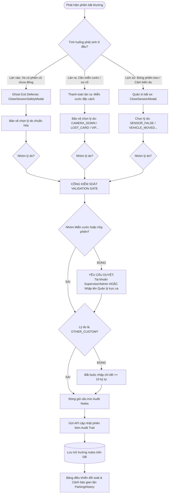

# QUY TRÌNH XỬ LÝ PHIÊN BẤT THƯỜNG & CHỐNG GIAN LẬN VẬN HÀNH
*(Abnormal Parking Session & Anti-Fraud Governance Standard)*

- **Mã tài liệu**: `SOP-ABNORMAL-SESSION-01`
- **Phạm vi áp dụng**: Bốt trực kiểm soát xe (Làn vào / Làn ra), Phòng điều hành (Supervisor), Kiểm toán doanh thu (Audit/Accounting).
- **Trạng thái**: Hoàn thiện & Đã triển khai trên Frontend client.
- **Tương thích Backend**: Sử dụng trường dữ liệu `notes TEXT` chuẩn hóa, không yêu cầu thay đổi DB schema.

---

## 1. Mục Đích & Nguyên Tắc Cốt Lõi

1. **Minh bạch tài chính (Zero Dark Revenue)**: Mọi thao tác can thiệp cước phí (giảm giá, miễn cước, hủy phiên) đều phải để lại vết kiểm toán điện tử (Audit Trail) có định danh người thực hiện và người phê duyệt.
2. **Chống thất thoát & Gian lận (Anti-Fraud Defense)**: Ngăn chặn triệt để hành vi bảo vệ tự ý thu tiền mặt của khách nhưng ghi nhận hệ thống là "Miễn cước đặc cách" để đút túi riêng.
3. **Giải tỏa ách tắc nhanh chóng (SLA $\le$ 30s)**: Đảm bảo giao diện cung cấp các lựa chọn chuẩn hóa (Chips / Combobox) để thao tác trong vòng 10–30 giây, không gây ùn tắc làn xe giờ cao điểm.
4. **Bảo toàn dữ liệu giải quyết khiếu nại**: Cung cấp đầy đủ bằng chứng (Ảnh chụp camera vào/ra, biển số thực tế, lý do giải trình) khi chủ phương tiện hoặc ban quản lý khiếu nại.

---

## 2. Sơ Đồ Luồng Xử Lý Nghiệp Vụ (End-to-End Workflow)



---

## 3. Danh Mục Lý Do Chuẩn Hóa & Phân Nhóm Thẩm Quyền

| Nhóm nghiệp vụ (`group_code`) | Mã lý do (`reason_code`) | Nhãn hiển thị | Yêu cầu phê duyệt Quản lý? | Mức độ cảnh báo rủi ro |
| :--- | :--- | :--- | :---: | :---: |
| **Miễn cước đặc cách**<br>`ghost_exit` | `CAMERA_DOWN_ENTRY` | Camera lỗi không ghi nhận lúc vào | **BẮT BUỘC** | 🔴 Cao (Rất dễ gian lận tiền mặt) |
| | `LOST_CARD_VERIFIED` | Thẻ mất, đã xác minh giấy tờ xe | **BẮT BUỘC** | 🟡 Trung bình |
| | `VIP_BMGR_WAIVER` | Xe VIP / Ban quản lý duyệt miễn | **BẮT BUỘC** | 🔴 Cao (Cần đối chiếu danh sách VIP) |
| | `EMERGENCY_MISSION` | Xe công vụ (Công an, Cứu hỏa, Cấp cứu) | **BẮT BUỘC** | 🟢 Thấp (Có còi/đèn ưu tiên) |
| **Hủy phiên lỗi nhận diện**<br>`cancel_glitch` | `OCR_MISREAD` | Camera nhận diện sai biển số | **BẮT BUỘC** | 🟡 Trung bình (Cần đối chiếu ảnh) |
| | `DUPLICATE_ENTRY_U_TURN` | Xe quay đầu 2 lần / Trùng lặp | **BẮT BUỘC** | 🟡 Trung bình |
| | `SYSTEM_TEST` | Kỹ thuật kiểm tra hệ thống | **BẮT BUỘC** | 🟡 Trung bình |
| **Giải phóng ô ảo**<br>`release_slot` | `SENSOR_FALSE_OCCUPIED` | Cảm biến báo ảo / Lỗi vị trí đỗ | Tự động ghi nhận NV | 🟢 Thấp |
| | `VEHICLE_MOVED_SLOT` | Xe đã đổi vị trí đỗ thực tế | Tự động ghi nhận NV | 🟢 Thấp |
| **Xuất bãi thủ công có thu tiền**<br>`manual_checkout` | `EXIT_GATE_POWER_OUT` | Mất điện cổng ra / Thu tiền ngoài | Ghi nhận NV thu tiền | 🔴 Cao (Bắt buộc nộp tiền về quỹ) |
| | `BARRIER_STUCK_CASH` | Barie kẹt cơ học, đã thu tiền | Ghi nhận NV thu tiền | 🔴 Cao (Bắt buộc nộp tiền về quỹ) |
| **Lý do khác** | `OTHER_CUSTOM` | Lý do đặc thù khác (Tự giải trình) | **BẮT BUỘC ($\ge 10$ ký tự)** | 🔴 Cực cao (Kiểm toán rà soát 100%) |

---

## 4. Ma Trận Phát Hiện & Phòng Chống Gian Lận (Anti-Fraud Matrix)

### 4.1. Kịch bản gian lận 1: Nuốt tiền vé mặt (Cash Pocketing)
- **Hành vi**: Khách gửi xe lâu ngày $\rightarrow$ Phí cao ($> 100.000$đ). Khách trả tiền mặt. Nhân viên bấm `VIP_BMGR_WAIVER` hoặc `CAMERA_DOWN_ENTRY` để hệ thống tính **0đ**, sau đó bỏ túi riêng số tiền mặt.
- **Biện pháp ngăn chặn**:
  1. **Dual-Authorization**: Phải có tài khoản Quản lý đăng nhập xác nhận hoặc nhập định danh Quản lý bảo lãnh trực tiếp trên màn hình bốt trực.
  2. **Audit Threshold Alert**: Phiên đỗ kéo dài $> 12$ tiếng hoặc cước phí tính toán $> 50.000$đ mà được miễn cước sẽ tự động kích hoạt cờ đỏ (Red Flag) trên Dashboard kiểm toán.
  3. **Lưu vết chi tiết**: Bắt buộc ghi rõ họ tên Quản lý trực ca bảo lãnh.

### 4.2. Kịch bản gian lận 2: Tráo biển số / Tráo vé ngắn hạn (Short-Stay Plate Swap)
- **Hành vi**: Xe A gửi nhiều ngày (phí cao). Xe B là xe của người quen vào bãi 5 phút. Nhân viên dùng lý do `OCR_MISREAD` để đổi biển số hoặc đóng phiên xe A bằng vé của xe B để chỉ trả phí vài nghìn đồng.
- **Biện pháp ngăn chặn**:
  1. Giao diện modal **CloseSessionSafetyModal** và **Thanh toán làn ra** bắt buộc hiển thị song song ảnh chụp camera làn vào và ảnh chụp thực tế làn ra.
  2. Kiểm toán viên định kỳ so sánh ảnh chụp NVR và bản ghi hệ thống đối với tất cả các giao dịch có mã `OCR_MISREAD`.

### 4.3. Kịch bản gian lận 3: Mở barie thủ công rồi quên/xóa dữ liệu
- **Hành vi**: Khi mất điện hoặc barie lỗi, nhân viên gạt tay cho xe qua nhưng không nhập hệ thống, hoặc nhập với lý do `EXIT_GATE_POWER_OUT` nhưng khai báo giảm số tiền thực thu.
- **Biện pháp ngăn chặn**:
  1. Hệ thống đếm xung độc lập của vòng từ (Loop Detector) so sánh với số phiên được đóng trên phần mềm.
  2. Toàn bộ phiên gắn mã `EXIT_GATE_POWER_OUT` hoặc `BARRIER_STUCK_CASH` đều được đưa vào danh sách **"Phải nộp tiền mặt đối soát ca"** để thủ quỹ thu đủ.

---

## 5. Quy Chuẩn Đóng Gói Dữ Liệu Kiểm Toán (Audit Trail Data Format)

Do Backend chưa mở rộng bảng riêng cho Audit Log, toàn bộ thông tin kiểm toán đối soát được đóng gói đồng nhất vào trường `notes TEXT` theo chuẩn:

```text
[GROUP:<group_code>] [REASON:<reason_code>] [LABEL:<reason_label>] [ACTOR:<actor_name>] [APPROVER:<approver_name>] [DETAIL:<custom_detail>]
```

### Ví dụ dữ liệu thực tế:
1. **Trường hợp Miễn cước đặc cách có quản lý duyệt**:
   ```text
   [GROUP:ghost_exit] [REASON:CAMERA_DOWN_ENTRY] [LABEL:Camera lỗi không ghi nhận lúc vào] [ACTOR:Bảo vệ NV01] [APPROVER:Nguyễn Văn Quản Lý] [DETAIL:Khách vào lúc 8h sáng, camera làn 1 mất mạng]
   ```
2. **Trường hợp Nhập lý do khác đặc thù**:
   ```text
   [GROUP:other] [REASON:OTHER_CUSTOM] [LABEL:Lý do khác] [ACTOR:Lê Văn C] [APPROVER:Trần Quản Đốc] [DETAIL:Xe cấp cứu chở bệnh nhân chuyển viện khẩn cấp, bảo vệ mở làn khẩn cấp]
   ```

---

## 6. Quy Trình Giải Quyết Khiếu Nại (Dispute Resolution SOP)

Khi có khiếu nại từ khách hàng (bị tính tiền sai, thẻ bị báo đã ra, hoặc bảo vệ từ chối mở cổng):

1. **Bước 1: Tra cứu nhanh tại `ParkingHistory`**:
   - Sử dụng bộ lọc "Đối soát / Xử lý" chọn nhóm tương ứng (`Miễn cước đặc cách`, `Hủy phiên`, hoặc `Tất cả phiên bất thường`).
   - Nhập biển số xe khiếu nại vào ô tìm kiếm.
2. **Bước 2: Kiểm tra Huy hiệu & Tooltip Kiểm toán**:
   - Rê chuột vào huy hiệu màu xanh tím `📋 [Lý do]` để xem tức thì:
     - *Ai là người xử lý?*
     - *Ai là người phê duyệt?*
     - *Nội dung giải trình thực tế là gì?*
3. **Bước 3: Đối chiếu chứng cứ hình ảnh**:
   - Mở chi tiết phiên đỗ, xem ảnh chụp camera lúc vào và lúc ra.
   - Nếu biển số nhận diện OCR khác biển số thực tế trong ảnh $\rightarrow$ Căn cứ vào ảnh thật để giải quyết trả xe hoặc hoàn tiền cho khách.
4. **Bước 4: Biên bản xử lý**:
   - Trong trường hợp nhân viên cố tình thao tác sai gây thất thoát, xuất dữ liệu audit trail từ `ParkingHistory` làm căn cứ xử lý trách nhiệm cá nhân.
