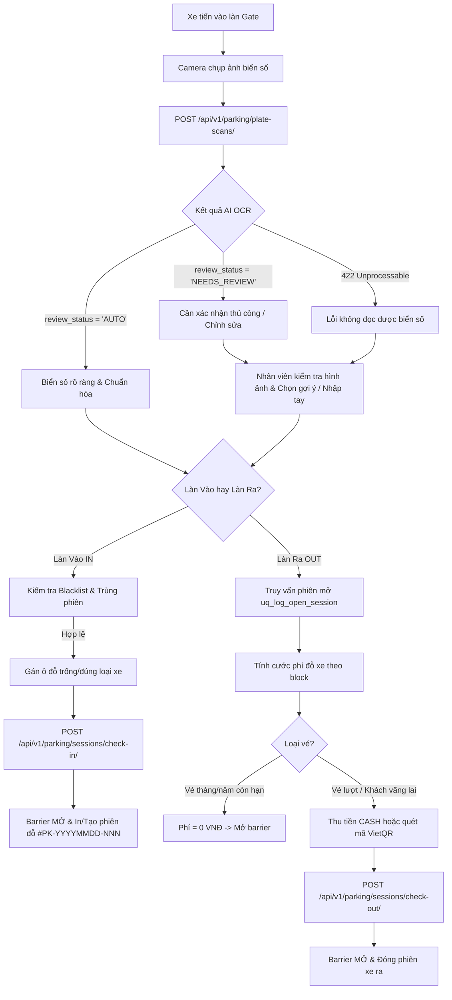

# Đặc tả Nghiệp vụ Xử lý Xe Ra Vào & Checklist Trường Hợp Đặc Biệt (Vehicle Entry/Exit Workflow & Special Cases)

> **Mã tài liệu**: `FE-SPEC-VEHICLE-ENTRY-EXIT`  
> **Phiên bản**: v1.0  
> **Phạm vi**: Frontend Client (`parking_management_frontend`) tích hợp REST API Backend (`parking_management_backend`)  
> **Hệ thống liên quan**: `ScanPlateLanePanel`, `ScanPlateCameraFeed`, `parkingSessionService.js`, `plateScanService.js`  
> **Căn cứ nghiệp vụ**: SRS v4.1 (Mục 4.5.1, 4.5.2), Database Alignment (`TL-05`, `TL-06`, `TL-08`, `TL-09`, `TL-17`, `TL-38`, `TL-50`, `TL-51`), Backend API Guide (`05-parking-endpoints.md`).

---

## 1. Tổng quan Kiến trúc Luồng Xử lý

Hệ thống quản lý làn xe ra vào (Làn vào / Làn ra) hoạt động theo nguyên tắc kết hợp **Tự động nhận diện biển số (AI OCR)** và **Giám sát / Phê duyệt thủ công (Human-in-the-Loop)** của Nhân viên vận hành (`EMPLOYEE` / `MANAGER`).

---

## 2. Chi tiết Nghiệp vụ Làn Xe Vào (Vehicle Check-In)

### 2.1 Các bước thực thi trên giao diện Frontend

1. **Nhận diện biển số (Scan Step)**:
   - Camera cổng vào (`direction: "IN"`) kích hoạt sự kiện chụp ảnh hoặc tải tệp qua `POST /api/v1/parking/plate-scans/`.
   - Payload: FormData gồm `image` (JPEG/PNG/WebP <= 5MB) và `gate_id`.
   - Kết quả trả về gồm: `plate_raw`, `plate_final`, `ai_confidence`, `review_status`, `vehicle_lookup`.

2. **Kiểm tra thông tin phương tiện (Vehicle Verification)**:
   - Nếu biển số đã đăng ký khách hàng (`vehicle_lookup !== null`):
     - Hiển thị thẻ xe: Chủ sở hữu (`KHxxxx`), Hãng/Dòng xe, Màu sắc.
     - Kiểm tra trạng thái vé: Có vé tháng/quý (`VTxxxx`) đang `ACTIVE` không.
     - Kiểm tra vị trí cố định đã gán (`parking_position`: Tầng, Khu, Ô).
   - Nếu là khách vãng lai (`vehicle_lookup === null` hoặc `vehicle_id === null`):
     - Hệ thống xử lý theo cơ chế **Unregistered Visitor** (`TL-05`, `TL-17`).

3. **Chọn ô đỗ xe (Slot Allocation)**:
   - Ưu tiên 1: Ô đỗ đã gán cố định cho xe có vé tháng/quý/năm.
   - Ưu tiên 2: Ô đỗ trống gần nhất phù hợp loại xe (`CAR` xăng hoặc `EV` trạm sạc điện - `TL-38`).
   - Cấm chọn ô đang bảo trì (`MAINTENANCE`) hoặc ô đang có xe đỗ (`OCCUPIED`).

4. **Xác nhận mở cổng (Barrier Open Confirmation)**:
   - Gửi yêu cầu `POST /api/v1/parking/sessions/check-in/` kèm:
     - `license_plate`: Biển số xe.
     - `entry_gate_id`: ID cổng vào (hướng `IN`).
     - `slot_id`: Vị trí ô đỗ được phân bổ.
     - `entry_image_url`: Đường dẫn ảnh Cloudinary đã scan.
     - `ai_confidence`, `recognition_source` (`AI` hoặc `MANUAL`), `review_status`.
   - Backend phản hồi `201 Created` kèm `session_code` dạng `#PK-YYYYMMDD-NNN`. Cổng barrier nâng lên cho xe vào.

---

## 3. Chi tiết Nghiệp vụ Làn Xe Ra (Vehicle Check-Out)

### 3.1 Các bước thực thi trên giao diện Frontend

1. **Quét biển số xe ra**:
   - Camera cổng ra (`direction: "OUT"`) thực hiện scan ảnh qua `POST /api/v1/parking/plate-scans/`.
   - Tự động lấy `vehicle_lookup.open_session` hoặc gọi tìm kiếm phiên mở bằng `license_plate`.

2. **Đối soát hình ảnh & Dữ liệu vào-ra (Visual Cross-Check)**:
   - Hiển thị song song 2 khung hình:
     - **Ảnh lúc vào**: `entry_image_url`, thời điểm vào `entry_time`, biển số ghi nhận ban đầu.
     - **Ảnh lúc ra**: Ảnh camera hiện tại cổng ra.
   - Nhân viên quan sát nhanh tránh tình trạng tráo biển số hoặc mượn xe khác gắn biển giả.

3. **Tính toán cước phí & Phân loại thanh toán (`TL-50`)**:
   - **Trường hợp Vé kỳ hạn còn hiệu lực**: Phí gửi xe = **0 VNĐ**.
   - **Trường hợp Khách vãng lai / Vé lượt**:
     - Phí tính theo block thời gian đỗ xe: Công thức chuẩn từ Backend `fee_amount` (ví dụ: 10.000 VNĐ / block giờ).
     - Hỗ trợ 2 phương thức thanh toán (`TL-07`):
       - `CASH`: Tiền mặt (nhân viên thu tiền trực tiếp và xác nhận).
       - `VIETQR`: Sinh mã QR động chuẩn VietQR có số tiền và nội dung chuyển khoản `PAY-SES-...`.

4. **Kết thúc phiên & Mở barrier**:
   - Gửi `POST /api/v1/parking/sessions/check-out/`:
     - Payload: `{"session_code": "#PK-...", "exit_gate_id": gateId, "payment_method": "CASH"|"VIETQR", "exit_image_url": url}`.
   - Backend trả về `200 OK`, cập nhật `exit_time`, sinh bản ghi giao dịch `payment` trạng thái `PAID`.
   - Vị trí ô đỗ `slot_id` tự động giải phóng trạng thái về `AVAILABLE`.

---

## 4. Contract API Tương Tác Giữa Frontend & Backend

| Phương thức | Endpoint | Chức năng Frontend | Lưu ý bắt buộc |
|---|---|---|---|
| `GET` | `/api/v1/parking/gates/?direction=IN\|OUT` | Lấy danh sách cổng vào/ra | Lọc cổng đang `is_active: true`, đúng hướng làn |
| `POST` | `/api/v1/parking/plate-scans/` | AI OCR đọc biển số & tìm xe | `multipart/form-data`, file <= 5MB, xử lý 9 review codes |
| `GET` | `/api/v1/parking/vehicle-lookup/?license_plate=...` | Tra cứu chi tiết xe & phiên mở | Trả về 404 (`MSG-4.5.1-M01`) nếu xe vãng lai |
| `GET` | `/api/v1/parking/vehicle-search/?q=...` | Tìm kiếm xe theo từ khóa | Tối thiểu 2 ký tự (`PROP-GEN-P01`) |
| `POST` | `/api/v1/parking/sessions/check-in/` | Tạo phiên đỗ xe vào bãi | Phải gửi kèm `X-CSRFToken`, khóa nút bấm chống race-condition |
| `POST` | `/api/v1/parking/sessions/check-out/` | Thanh toán & đóng phiên xe ra | Cổng ra phải có `direction="OUT"`, bắt buộc `payment_method` nếu phí > 0 |
| `GET` | `/api/v1/parking/sessions/` | Xem danh sách lịch sử ra/vào | Hỗ trợ phân trang, lọc theo biển số, khoảng ngày |

---

## 5. Checklist Toàn Diện Các Trường Hợp Đặc Biệt (Edge Cases Checklist)

Nhân viên vận hành và giao diện Frontend **bắt buộc** xử lý chính xác các kịch bản bất thường sau:

### Nhóm A: Lỗi Nhận Diện Biển Số & Chất Lượng Ảnh (AI OCR Edge Cases)

- [ ] **A1. Ảnh mờ, chói lóa, góc chụp quá nghiêng (`LOW_IMAGE_SHARPNESS`, `IRREGULAR_ASPECT_RATIO`)**:
  - Giao diện bật cảnh báo màu vàng: *"Hình ảnh mờ hoặc góc chụp lệch, vui lòng kiểm tra lại"*.
  - Cho phép bấm nút *"Chụp lại"* hoặc tải ảnh rõ hơn.
- [ ] **A2. Không nhận diện được biển số (HTTP 422 - `PROP-4.5.1-P06`)**:
  - Không chặn đứng quy trình. Bật ô `Input` thủ công cho nhân viên gõ trực tiếp biển số xe nhìn thấy từ camera.
- [ ] **A3. Độ tin cậy ký tự thấp (`LOW_CHAR_CONFIDENCE` < 90%)**:
  - Tô màu highlight các ký tự bị nghi ngờ (dưới ngưỡng 90%) trên thẻ hiển thị biển số.
- [ ] **A4. Xung đột giữa 2 mô hình AI (`MODEL_DISAGREEMENT`)**:
  - Hiển thị danh sách các ứng viên (`candidates`) song song để nhân viên click chọn 1 trong 2 với 1 thao tác.
- [ ] **A5. Nhầm lẫn ký tự số và chữ (Tự động áp dụng Grammar Correction - `POSITION_CORRECTED`)**:
  - Ví dụ: vị trí chữ cái bị đọc thành số `0` hoặc vị trí số bị đọc thành chữ `O` / `D` / `8` / `B`.
  - Hiển thị danh sách gợi ý (`suggestions`) để nhân viên xác nhận nhanh thay vì phải gõ lại toàn bộ.
- [ ] **A6. Biển số xe quân đội / ngoại giao / định dạng đặc biệt (`PROP-4.5.1-P16`)**:
  - Đánh dấu trạng thái `NEEDS_REVIEW`, yêu cầu nhân viên xác nhận trước khi cho phép mở barrier.

---

### Nhóm B: Bất Thường Logic Phiên Đỗ & Trùng Lặp (Session & State Edge Cases)

- [ ] **B1. Xe vào nhưng đã có phiên đang mở chưa đóng (HTTP 409 - `PROP-4.5.1-P07`)**:
  - **Hiện tượng**: Xe chạy vào cổng nhưng trong DB biển số này vẫn đang có phiên mở (`exit_time IS NULL`) do lần trước vượt barrier hoặc nhân viên chưa check-out.
  - **Xử lý UI**:
    - Hiển thị modal cảnh báo an toàn (`CloseSessionSafetyModal`): *"Biển số này đã có phiên đỗ xe chưa kết thúc từ ngày DD/MM lúc HH:mm"*.
    - Ngăn chặn tuyệt đối việc tự ý đóng phiên tự động gây thất thoát doanh thu.
    - Cung cấp 2 kịch bản xử lý bắt buộc chọn lý do chuẩn hóa:
      1. `manual_checkout`: Xuất bãi có thu tiền (tính cước thực tế từ thời điểm vào đến nay).
      2. `cancel_glitch`: Hủy phiên do lỗi nhận diện/phiên ảo (0đ & giải phóng ô đỗ).
- [ ] **B2. Xe ra nhưng không tìm thấy phiên vào (HTTP 404 / Ghost Exit - `ST-CORE-07`)**:
  - **Hiện tượng**: Xe ra cổng nhưng quét camera không tìm thấy phiên mở trong hệ thống (do camera vào lỗi, mất điện lúc vào, hoặc xe lạ vượt trạm).
  - **Xử lý UI**:
    - Chặn hoàn toàn nút Mở Barrier mặc định (`⛔ Khóa: Ghost Exit (ST-CORE-07)`).
    - Chỉ tài khoản quyền Quản lý (`MANAGER`) mới có thẩm quyền mở barrier đặc cách khi chọn **"Miễn cước đặc cách"** và **bắt buộc nhập lý do sự cố**.
- [ ] **B3. Xe ra nhưng phiên đã bị đóng trước đó (HTTP 409 - `PROP-4.5.1-P10`)**:
  - Ngăn chặn tình trạng nhân viên bấm đúp (double-click) hoặc 2 nhân viên cùng thao tác check-out một phiên.

---

### Nhóm B.1: Quy Chuẩn Xử Lý Phiên Bất Thường & Vết Kiểm Toán (Audit Trail)

Áp dụng cho cả 2 modal can thiệp: `CloseSessionModal` (trên Lịch sử ra/vào) và `CloseSessionSafetyModal` (tại Làn Vào).

#### 1. Bốn Kịch Bản Nghiệp Vụ Chuẩn (Action Types)
1. **Xuất bãi có thu tiền (`manual_checkout`)**:
   - Dành cho xe ra bãi thực tế khi sự cố barrier hoặc cổng mất điện.
   - Tính đúng cước thực tế theo thời gian đỗ, xác nhận phương thức thu tiền (`CASH` hoặc `VIETQR`).
2. **Miễn cước đặc cách xuất bãi (`waive_fee` / `is_fee_exempt`)**:
   - Dành cho sự cố khách quan (mất thẻ đã xác minh CCCD, camera vào hỏng, xe ưu tiên/ngoại giao, khách VIP có công văn).
   - Cước phí: `0đ`. Bắt buộc quyền Quản lý (`MANAGER`).
3. **Hủy phiên lỗi nhận diện (`cancel_glitch`)**:
   - Camera quét nhầm biển số, quét lặp khi xe quay đầu ở cổng vào, hoặc phiên test kỹ thuật.
   - Cước phí: `0đ`. Giải phóng ô đỗ ngay lập tức.
4. **Chỉ giải phóng ô đỗ treo (`release_slot`)**:
   - Bảo vệ kiểm tra ô thực tế trống nhưng hệ thống bị khóa vị trí.
   - Giữ nguyên phiên xe, không trừ tiền khách, chỉ trả ô về trạng thái Trống.

#### 2. Danh Mục Lý Do Chuẩn Hóa (Preset Reasons) & Ràng Buộc Kiểm Toán
Để ngăn chặn nhân viên ghi chép sơ sài (như gõ "loi", "xe ra roi") gây thất thoát hoặc tranh chấp khiếu nại:
- **Bộ lý do chuẩn (Preset Chips)**: Giao diện hiển thị danh sách các thẻ lý do chuẩn để click chọn nhanh:
  - *Sự cố kỹ thuật*: "Camera làn vào không nhận diện / mất điện lúc xe vào", "Lỗi thẻ từ: Khách làm mất thẻ, đã đối soát CCCD & đăng ký xe".
  - *Quyết định miễn phí*: "Xe công vụ / cứu hỏa / cấp cứu làm nhiệm vụ", "Ban quản lý phê duyệt miễn cước đặc cách theo công văn".
  - *Lỗi dữ liệu / AI OCR*: "Camera nhận diện sai biển số (biển thực tế khác OCR)", "Quét lặp tạo phiên ảo: Xe quay đầu không vào bãi", "Phiên chạy thử nghiệm cân chỉnh camera".
  - *Sự cố bãi / Ô đỗ*: "Bảo vệ xác nhận ô thực tế trống, xe đã đổi vị trí khác".
- **Ràng buộc kiểm toán (Audit Trail Guard)**:
  - Bắt buộc lý do không được để trống và có độ dài tối thiểu 6 ký tự.
  - Ghi nhận `actor_id` (Tài khoản Quản lý duyệt), thời gian duyệt, ảnh đối soát camera vào/ra.
  - Mọi giao dịch miễn cước hoặc hủy phiên đều ghi nhận tiền tố `[MIỄN CƯỚC ĐẶC CÁCH]: <Lý do>` hoặc `[HỦY PHIÊN]: <Lý do>` vào trường `notes` trong `vehicle_entry_exit_log` và bảng tài chính `payment` để phục vụ thanh tra/kiểm toán đối soát khiếu nại.

---

### Nhóm C: An Ninh, Cảnh Báo & Danh Sách Đen (Security & Blacklist Edge Cases)

- [ ] **C1. Biển số xe nằm trong Danh sách đen (HTTP 409 - `PROP-4.5.1-P08`)**:
  - **Hiện tượng**: Xe thuộc diện cảnh báo nợ cước, trộm cắp, hoặc vi phạm nội quy bãi xe.
  - **Xử lý UI**:
    - Hiển thị thông báo khẩn cấp màu đỏ (Emergency Banner): *"CẢNH BÁO: Biển số xe nằm trong danh sách đen! Lý do: [Lý do blacklist]"*.
    - Khóa nút mở barrier tự động.
    - **Cơ chế ghi đè (Override)**: Chỉ tài khoản quyền Quản lý (`MANAGER`) mới có nút checkbox *"Tôi xác nhận cho phép xe vào (Ghi đè Blacklist)"* (`override_blacklist: true`).
    - Nhân viên thông thường (`EMPLOYEE`) nếu cố tình ghi đè sẽ bị chặn HTTP 403 (`PROP-4.5.1-P14`).

---

### Nhóm D: Quản Lý Ô Đỗ & Không Gian Bãi Xe (Parking Space & Compatibility)

- [ ] **D1. Ô đỗ chỉ định đang bận hoặc đang bảo trì (`PROP-4.5.2-P01`, `PROP-4.5.2-P02`)**:
  - Kiểm tra trạng thái ô đỗ theo thời gian thực. Nếu ô được chọn là `MAINTENANCE` hoặc `OCCUPIED`, tự động gợi ý ô trống khả dụng khác cùng tầng/khu.
- [ ] **D2. Không tương thích loại xe với ô đỗ (`TL-38` - `PROP-SLOT-VEHICLE-TYPE-MISMATCH`)**:
  - Xe xăng (`CAR`) không được phép đỗ vào ô sạc xe điện chuyên dụng (`EV`), và ngược lại nếu ô đỗ có giới hạn nghiêm ngặt.
  - UI cảnh báo ngay tại dropdown chọn ô đỗ xe.
- [ ] **D3. Bãi xe đã hết chỗ (Full Capacity)**:
  - Hiển thị badge: *"Bãi xe đã đầy chỗ trống"* trên màn hình điều khiển làn vào.
  - Vẫn cho phép xe có vé tháng/vé năm đã gán ô cố định vào bãi.

---

### Nhóm E: Khách Vãng Lai & Vé Tháng / Hết Hạn (Visitor & Ticket Expiry)

- [ ] **E1. Khách vãng lai không có thông tin chủ xe (`TL-05`)**:
  - Không bắt buộc nhập tên khách hàng hay số điện thoại. Gán `vehicle_id = null`, lưu biển số xe và mã phiên `#PK-...`.
- [ ] **E2. Xe có vé tháng nhưng đã hết hạn (Expired Ticket)**:
  - Hiển thị cảnh báo màu cam: *"Vé tháng đã hết hạn vào ngày DD/MM/YYYY"*.
  - Tự động chuyển hình thức tính cước sang **Vé lượt (Khách vãng lai)** tính theo block giờ thông thường.
- [ ] **E3. Xe có vé tháng sắp hết hạn (Expiring Soon <= 7 ngày)**:
  - Hiển thị badge nhắc nhở trên màn hình cổng: *"Vé sắp hết hạn (còn X ngày)"* để nhân viên thông báo cho khách hàng gia hạn.

---

### Nhóm F: Thanh Toán Cổng Ra & Sự Cố Mạng (Payment & Connectivity Edge Cases)

- [ ] **F1. Thanh toán VietQR lỗi hoặc khách hàng chưa chuyển tiền**:
  - Hỗ trợ nút *"Chuyển sang tiền mặt"* (`Switch to CASH`) ngay lập tức mà không cần hủy bỏ quét lại từ đầu.
- [ ] **F2. Mất kết nối mạng / Cloudinary upload thất bại (HTTP 502 - `PROP-4.5.1-P17`)**:
  - Hiển thị thông báo lỗi dịch vụ đám mây, cho phép chuyển sang chế độ dự phòng mở barrier cơ học thủ công và ghi nhận nhật ký vận hành khẩn cấp.
- [ ] **F3. Race Condition & Chặn bấm đúp (Double-Click Guard)**:
  - Nút *"Xác nhận vào / Check-in"* và *"Thanh toán & Check-out"* phải được disable ngay sau lần click đầu tiên kèm spinner loading, chống sinh 2 phiên đỗ trùng lặp.

---

## 6. Tiêu Chuẩn Trải Nghiệm Giao Diện Người Dùng (UI/UX Guidelines)

1. **Bố cục 2 cột trực quan (Dual Lane Layout)**:
   - Cột trái: Trực tiếp luồng camera, nút chụp/tải ảnh, biển số nhận diện to rõ ràng (font chữ biển số chuẩn, cỡ chữ >= 24px).
   - Cột phải: Thông tin thẻ xe, khách hàng, vị trí ô đỗ, trạng thái vé và bảng phí thanh toán.
2. **Quy tắc phím tắt cho nhân viên trạm**:
   - `Enter`: Xác nhận Cho xe vào / Check-in (khi review_status = `AUTO`).
   - `Space`: Xác nhận Thanh toán tiền mặt & Cho xe ra.
   - `F2`: Chuyển nhanh giữa chế độ Camera và Tải ảnh.
   - `Esc`: Đóng các hộp thoại cảnh báo / modal.
3. **Tuân thủ Clean Code & Frontend Guardrails**:
   - Tất cả các component con trong `components/VehicleManagement/scanPlate/` phải được module hóa, không vượt quá 200 dòng.
   - Trạng thái bất đồng bộ phải có cleanup để tránh memory leak.
   - Mọi khoản tiền và phí tính toán phải định dạng chuẩn `vi-VN` (ví dụ: `10.000 đ`).
